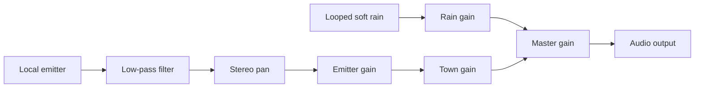

# Sound engine development plan

Build the Web Audio engine around the first playable café scene. A listener should hear gentle rain, locate the café by moving the pointer, and hear its sound give way to the bookshop as the fog clears. Then extend the same engine to the two-street prototype and the full sound inventory.

## Use the existing scene model

| Input | Engine responsibility |
| --- | --- |
| `Scene.soundscape` | Play its `RainBed` and register its `SoundEmitter` records. Reuse the cue choices in `USE_SOUND_CUES` and `STREET_SOUND_CUES` when building those records. |
| `SoundAssets` | Resolve each `SoundCue` to the available local takes. Keep cue identity independent of clip filenames. |
| `Listener` | Update the mix from its eased `position`. The app sets `targetPosition` from the pointer or touch along the street. |
| `RegenerationTransition` and `TransitionTimings` | Follow the app's cover, replace, and reveal phases. Use the agreed cover and reveal durations to schedule gain changes. |

Keep the audio context, decoded buffers, scheduled events, and live nodes in the browser runtime. Add DOM types for Web Audio when extending the TypeScript package with Vite. [Sound model](../src/model/sound.ts) · [Regeneration model](../src/model/regeneration.ts) · [Technology](technology.md)

## 1. Load the pilot files and start the rain

- Read the local audio manifest into `SoundAssets`. Map catalog cue IDs explicitly to the existing `SoundCue` values, such as `wet_pavement_footsteps`. Resolve local asset URLs through the build so they work at a site root and under `/fog/`. Keep creator, source, license, and edit records in the manifest.
- Start with soft stereo rain, café murmur, a milk-steamer hiss, and a quiet bookshop cue. Exercise the mixer with short original fixtures while the pilot recordings are being sourced. Use original or CC0 recordings for the listening checks. Keep one shared decode cache by file URL and share a pending decode across requests. Clear failed entries so a later load can retry.
- Create or resume one `AudioContext` directly in the first click or tap handler. The same gesture can select a scene target. Start one seamlessly looping rain take once audio is ready. Reuse that source on scene updates and repeated attempts to enable sound.

All activity besides the steady rain bed goes through the town gain, including local rain on leaves and gutter drips.

**Done when** the first gesture on desktop and touch starts one rain loop, repeat gestures reuse it, and the loop seam sounds clean.

## 2. Place and mix the café sounds

- Place a stationary café emitter at the door using the scene's resolved position. An indoor emitter can represent a voice heard through glass. Give the bookshop a compatible emitter at its own entrance.
- Pan from the horizontal difference between emitter and listener. Use distance to lower gain, scaling the normalized depth difference into scene units before combining it with horizontal distance. Soften high frequencies for distant and indoor emitters. Smooth gain, pan, and filter changes as the listener moves.
- Create a fresh buffer source for each playback event. Reuse decoded audio and disconnect the source when playback ends. Update the playing source's mix as the listener moves.

**Done when** the café grows louder on the right as the listener approaches from the left, centers when they reach the door, and recedes on the left. A deeper or indoor emitter should sound more muffled.

## 3. Synchronize the mix with fog

Use the app's transition phase to coordinate drawing and audio. Schedule ramps on the audio clock so their timing follows the fog even when drawing frames arrive unevenly.

| Phase | Audio action |
| --- | --- |
| **Cover** | Pause new town events and cancel queued starts. Fade the sources already playing by ramping the town gain toward silence over `coverMs`. Prepare takes for the candidate scene as they become available. |
| **Replace** | When the target is covered, set the town gain to zero. Install the new emitter set together with the scene geometry and click targets. Stop sources and cancel events for retired emitters. |
| **Reveal** | Mix using the current listener position, resume town scheduling, and ramp the town gain back in over `revealMs`. If generation exhausted its options, restore playback for the prior emitter set. |

Keep the original rain source playing through building, street, and town changes. Tie queued events and asynchronous audio loads to the active scene so an old café take arriving late cannot start in the bookshop. Let the visual transition continue while the audio context is suspended or an optional cue loads. On resume, apply the current phase and emitter set before starting any events.

**Done when** the café-to-bookshop reveal reaches a moment with only the rain audible, the new ambience fades in around the current listener, and a failed replacement restores the prior soundscape. Use the same checks when road and sky clicks are added.

## 4. Schedule variations and moving sources

- Start intermittent events according to each `SoundProfile.gapMs` range and gain. Keep quiet stretches and limit overlapping foreground activity. Use the audio clock for event timing.
- For each cue, shuffle its available takes and cycle through them. At the start of a new cycle, choose a first take different from the last one when alternatives exist. Collect at least three distinct takes per cue where available. Play from smaller groups when that is what the manifest provides. Leave an unavailable cue silent and report the gap.
- Add footsteps and a passing car to the street and laughter to the park. For `EmitterMotionKind.AlongPath`, advance the emitter along its polyline over the event and update its pan and gain while it moves. Use through-route cues where the street supports them.
- Expand using the inventory once the first street sounds work. Tune the balance by site so cafés, schools, churches, and parks have recognizable cues while rain remains the main ambience.

**Done when** the two-street prototype plays the available takes without immediate repeats, a passing source moves across stereo even with a stationary listener, and local children, café, and traffic cues leave room for the rain. [Sound inventory](sound-inventory.md)

## 5. Verify the production build

| Check | Expected result |
| --- | --- |
| Cue selection and mixing | Focused tests cover shuffle boundaries, one-take groups, missing clips, pan direction, and distance attenuation. |
| Repeated regeneration | Building, road, and sky swaps fade the town mix cleanly. The rain keeps playing and retired emitters release their nodes and scheduled work. |
| Delayed loads and resume | A failed clip stays local to its cue. Delayed takes from retired scenes stay silent. Audio resumes with the current scene and phase. |
| Desktop and phone | A first click or tap enables audio. Pointer movement and touch drag move the listener smoothly. Listen through a café reveal and a passing car. |
| Static hosting | The built app resolves audio at the root and under a subpath. Load the cues needed by the current scene and use measured playback and memory behavior to tune caching and overlap limits. |
| Listening | Verify the rain loop, quiet gaps, natural cue tails, and indistinct voices at the intended mix levels. |

**Done when** the built app passes the desktop and phone listening checks and repeated reveals play reliably with the documented local audio pack. [Development plan](development-plan.md) · [Soundscape and sound engine](soundscape-and-sound-engine.md)
